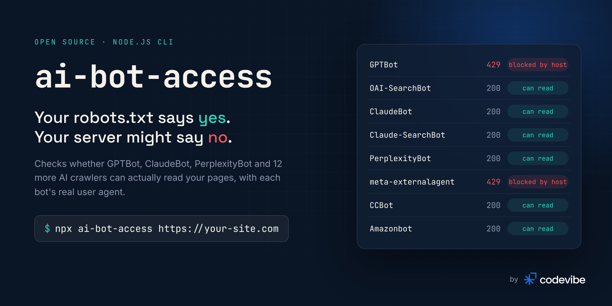
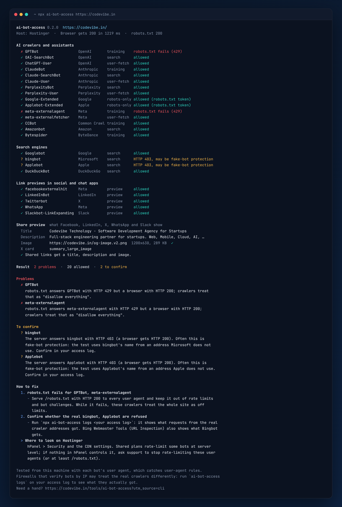

<p align="center">
  
</p>

<p align="center">
  <a href="https://www.npmjs.com/package/ai-bot-access"></a>
  <a href="https://www.npmjs.com/package/ai-bot-access"></a>
  <a href="https://github.com/codevibe-technology/ai-bot-access/actions/workflows/ci.yml"></a>
  
  <a href="LICENSE"></a>
</p>

<p align="center">
  <b>Can ChatGPT, Claude and Perplexity actually read your website?</b><br>
  One command checks 15 AI crawlers against your robots.txt <i>and</i> your real server response.
</p>

<p align="center">
  <a href="#quick-start">Quick start</a> ·
  <a href="#why-this-exists">Why</a> ·
  <a href="#what-it-checks">What it checks</a> ·
  <a href="#verdicts">Verdicts</a> ·
  <a href="#use-it-in-ci">CI</a> ·
  <a href="#use-it-from-code">API</a> ·
  <a href="#faq">FAQ</a>
</p>

---

## Quick start

```bash
npx ai-bot-access https://your-site.com
```

No install, no API key, no account, zero dependencies. Needs Node.js 18.17 or newer.

<p align="center">
  
</p>

## Why this exists

AI assistants now answer questions that used to send people to search results. If their crawlers cannot read your pages, you are not in those answers, and nothing tells you.

Most people check this by reading their **robots.txt**. That is only half the story. Hosting providers, CDNs and firewalls increasingly block AI bots **by user agent**: a `403`, a `429` rate limit, or a "verify you are human" page. robots.txt still says *Allow*, every online checker says you are fine, and the bot is locked out anyway.

We found exactly this on our own site, [codevibe.in](https://codevibe.in?utm_source=github&utm_medium=readme&utm_campaign=ai-bot-access&utm_content=body). Our robots.txt allowed every AI crawler. Our shared host answered **every GPTBot request with HTTP 429**, including the request for robots.txt itself. A crawler that cannot fetch robots.txt treats the whole site as disallowed, so OpenAI's crawler could not read a single page. The screenshot above is the real output.

`ai-bot-access` makes that second check easy: it asks for your page the way each bot does and compares the answer with what a normal browser gets.

## What it checks

For every bot, two things:

| | Check | How |
| --- | --- | --- |
| 1 | **robots.txt rules** | Fetches robots.txt *with that bot's user agent* and applies [RFC 9309](https://www.rfc-editor.org/rfc/rfc9309): exact token groups, `*` fallback, longest-match rules, `*` and `$` wildcards |
| 2 | **What the server really does** | Requests the page with the bot's documented user agent and compares it with a browser baseline: status code, challenge pages, redirects, `noindex` and `noai` directives |

### Supported bots

| Bot | Operator | Used for | Follows robots.txt |
| --- | --- | --- | :---: |
| `GPTBot` | OpenAI | Model training | ✅ |
| `OAI-SearchBot` | OpenAI | ChatGPT search | ✅ |
| `ChatGPT-User` | OpenAI | Fetching a page a user asked about | Not always |
| `ClaudeBot` | Anthropic | Model training | ✅ |
| `Claude-SearchBot` | Anthropic | Claude search | ✅ |
| `Claude-User` | Anthropic | Fetching a page a user asked about | ✅ |
| `PerplexityBot` | Perplexity | Perplexity search | ✅ |
| `Perplexity-User` | Perplexity | Fetching a page a user asked about | No |
| `Google-Extended` | Google | Gemini training control (robots.txt token only) | ✅ |
| `Applebot-Extended` | Apple | Apple Intelligence training control (robots.txt token only) | ✅ |
| `meta-externalagent` | Meta | Model training and indexing | ✅ |
| `meta-externalfetcher` | Meta | Fetching a page a user asked about | Not always |
| `CCBot` | Common Crawl | Open web dataset used for training | ✅ |
| `Amazonbot` | Amazon | Alexa and search | ✅ |
| `Bytespider` | ByteDance | Model training | Not always |

User agents come from each operator's own documentation, linked in [`src/bots.ts`](src/bots.ts). `Google-Extended` and `Applebot-Extended` are robots.txt tokens only (Google and Apple fetch with their normal crawlers), so the tool checks your rules for them without sending a separate request.

## Verdicts

| Verdict | Meaning | Usually caused by |
| --- | --- | --- |
| 🟢 `allowed` | robots.txt allows the bot and the page answers it like a browser | Nothing to do |
| 🟡 `blocked-by-robots` | Your robots.txt disallows this bot for this path | A choice you made, or forgot about |
| 🔴 `blocked-by-server` | robots.txt allows it, but the server answers the bot with 4xx/5xx while a browser gets the page | Host, CDN or WAF rule |
| 🔴 `challenged` | The bot gets a Cloudflare, DataDome, SiteGround, Imperva or similar challenge page | Bot protection settings |
| 🔴 `robots-unreachable` | robots.txt itself fails for the bot (429, 5xx, timeout). Crawlers then assume *everything* is disallowed | Host, CDN or WAF rule |
| 🔴 `error` | The page request failed (DNS, TLS, timeout) | Network or server trouble |

The report also flags `noindex`, `none`, `noai` and similar directives aimed at a bot, from `X-Robots-Tag` headers (including bot-scoped ones like `GPTBot: noindex`) and robots meta tags.

## Usage

```bash
# Every known bot against one page
npx ai-bot-access https://example.com/blog/my-post

# Only some bots: ids, robots tokens or operator names
npx ai-bot-access example.com --bots openai,anthropic
npx ai-bot-access example.com --bots gptbot,perplexitybot

# Full JSON report
npx ai-bot-access https://example.com --json > report.json

# List the bots this version knows
npx ai-bot-access --list
```

| Option | Description |
| --- | --- |
| `--bots <list>` | Comma-separated bot ids, robots tokens or operators |
| `--json` | Print the full report as JSON |
| `--strict` | Also fail (exit 1) when robots.txt blocks a bot |
| `--timeout <ms>` | Per-request timeout, default `15000` |
| `--delay <ms>` | Pause between requests, default `250`, so the check does not trip rate limits itself |
| `--list` | Show the supported bots |
| `--no-color` | Plain output (also respects `NO_COLOR`) |

**Exit codes:** `0` every bot that robots.txt allows can read the page · `1` a hidden block was found (with `--strict`, any block) · `2` invalid usage or the site is unreachable.

## Use it in CI

Hosting and firewall settings change without warning. A weekly check catches it before it costs you visibility:

```yaml
# .github/workflows/ai-bot-access.yml
name: AI bot access
on:
  schedule:
    - cron: '0 6 * * 1' # every Monday
  workflow_dispatch:
jobs:
  check:
    runs-on: ubuntu-latest
    steps:
      - uses: actions/setup-node@v4
        with:
          node-version: 22
      - run: npx ai-bot-access https://example.com --no-color
```

## Use it from code

```js
import { checkAiBotAccess } from 'ai-bot-access';

const report = await checkAiBotAccess('https://example.com/pricing', {
  bots: ['openai', 'anthropic'],
});

for (const r of report.results) {
  console.log(r.bot.token, r.verdict, r.reason);
}
console.log(`${report.summary.problems} problem(s)`);
```

The RFC 9309 parser is exported on its own too:

```js
import { parseRobots, isAllowed } from 'ai-bot-access';

const robots = parseRobots('User-agent: *\nDisallow: /admin\n\nUser-agent: GPTBot\nDisallow: /\n');

isAllowed(robots, 'GPTBot', '/blog');    // { allowed: false, matchedBy: 'token', rule: {...} }
isAllowed(robots, 'ClaudeBot', '/blog'); // { allowed: true,  matchedBy: 'wildcard' }
```

Full TypeScript types are included.

## How it works

1. **Baseline.** Fetch the page and robots.txt with a normal browser user agent.
2. **robots.txt per bot.** Fetch robots.txt again *with each bot's user agent*. A `2xx` is parsed. A `4xx` means "no robots.txt, everything allowed". A `429`, `5xx` or network failure means "assume everything is disallowed", which is how Google and most crawlers behave.
3. **Rules.** Pick the bot's group (exact token match, case-insensitive, groups combined, `*` fallback) and the most specific rule (longest pattern wins, `allow` wins a tie).
4. **Page.** Fetch the page with the bot's user agent and compare with the baseline: status, challenge pages, redirects, indexing directives.

Requests run one at a time with a short pause: about 30 requests for a full check.

## FAQ

<details>
<summary><b>My robots.txt allows everything. Why would a bot still be blocked?</b></summary>

robots.txt is a request to well-behaved crawlers. It does not control your server. Shared hosts, CDNs and WAFs often have their own "AI bot" or rate-limit rules keyed on the user agent, and those answer before your site does. That is exactly the gap this tool checks.
</details>

<details>
<summary><b>Is blocking AI bots bad?</b></summary>

Not necessarily. Blocking training crawlers like `GPTBot` or `CCBot` is a legitimate choice. But blocking search and user-fetch bots (`OAI-SearchBot`, `Claude-SearchBot`, `PerplexityBot`, `ChatGPT-User`) usually keeps you out of AI answers and citations. The point is that it should be your decision, not an accident.
</details>

<details>
<summary><b>Can I trust a result run from my laptop?</b></summary>

It catches blocks based on the user agent, which is how most hosting and WAF bot rules work. Firewalls that verify bots by IP address (for example Cloudflare's verified bot list) may treat the real crawler differently. If yours does, check its bot analytics too.
</details>

<details>
<summary><b>Will running it get my IP rate-limited?</b></summary>

It sends roughly 30 requests, one at a time with a 250 ms pause. Raise `--delay` if your site is sensitive.
</details>

<details>
<summary><b>A bot is missing or its user agent changed.</b></summary>

Please open an issue or pull request with a link to the operator's documentation. The bot list is a single file: [`src/bots.ts`](src/bots.ts).
</details>

## Limits

- Tests from your machine, not from the bots' own networks (see the FAQ).
- One URL per run. Rules can differ by path, so check your key templates: home, a blog post, a product page.
- Does not render JavaScript. Most AI crawlers do not either, so this matches what they see.

## Contributing

Contributions are welcome, especially bot list updates. See [CONTRIBUTING.md](.github/CONTRIBUTING.md).

```bash
git clone https://github.com/codevibe-technology/ai-bot-access.git
cd ai-bot-access
npm install
npm test        # robots.txt matching + a local server that simulates each kind of block
npm run build
node dist/cli.js https://example.com
```

## License

[MIT](LICENSE) © [Codevibe Technology](https://codevibe.in?utm_source=github&utm_medium=readme&utm_campaign=ai-bot-access&utm_content=license)

---

<p align="center">
  <a href="https://codevibe.in?utm_source=github&utm_medium=readme&utm_campaign=ai-bot-access&utm_content=footer-logo">
    <picture>
      <source media="(prefers-color-scheme: dark)" srcset=".github/assets/codevibe-logo-light.png">
      
    </picture>
  </a>
</p>

<p align="center">
  Built and maintained by <a href="https://codevibe.in?utm_source=github&utm_medium=readme&utm_campaign=ai-bot-access&utm_content=built-by"><b>Codevibe</b></a>, a software development agency in Gurugram, India.<br>
  We build web apps, mobile apps and AI products for startups, and we wrote this after finding our own site locked out of GPTBot.<br>
  <a href="https://codevibe.in?utm_source=github&utm_medium=readme&utm_campaign=ai-bot-access&utm_content=footer-links">Website</a> · <a href="https://codevibe.in/blog?utm_source=github&utm_medium=readme&utm_campaign=ai-bot-access&utm_content=footer-blog">Blog</a> · <a href="mailto:hello@codevibe.in">hello@codevibe.in</a>
</p>
